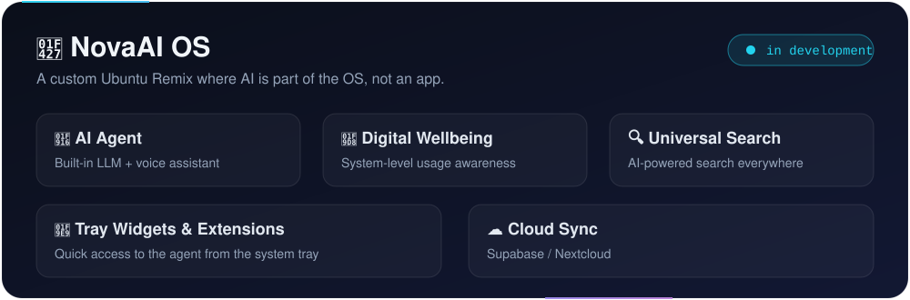

<div align="center">



<br/>

<a href="https://github.com/vishal51512"></a>
<a href="https://github.com/vishal51512?tab=repositories"></a>


</div>

<br/>

## 👨‍💻 About

```python
class Vishal:
    role       = "B.Tech CSE Student @ SKIT Jaipur"
    focus      = ["Linux", "AI Agents", "System Programming", "Productivity Tools"]
    building   = "NovaAI OS"
    learning   = ["Kernel Development", "Distributed Systems", "Security & Sandboxing"]
    philosophy = "Build things that actually help people."
```

<br/>

## 🔥 Currently Building

<div align="center">
  
</div>

<br/>

## 🛠️ Tech Stack

<div align="center">


</div>

<br/>

## 🌱 Learning Goals

| 🐧 Linux Kernel | ⚙️ System Programming | 🌐 Distributed Systems | 🤖 Agents + OS | 🔐 Security |
|:---:|:---:|:---:|:---:|:---:|
| Internals & dev | Low-level tooling | Scale & consistency | AI inside the OS | Sandboxing |

<br/>

## 🐍 Contribution Snake

<div align="center">
  <picture>
    <source media="(prefers-color-scheme: dark)" srcset="https://raw.githubusercontent.com/vishal51512/vishal51512/output/github-snake-dark.svg" />
    <source media="(prefers-color-scheme: light)" srcset="https://raw.githubusercontent.com/vishal51512/vishal51512/output/github-snake.svg" />
    
  </picture>
</div>

<br/>

## 🤝 Connect

<div align="center">

Open to **Open Source** · **Fedora Community** · **AI + OS ideas** · **Deep-tech collaborations**

<a href="https://github.com/vishal51512"></a>
<!-- <a href="https://linkedin.com/in/YOUR-ID"></a> -->
<!-- <a href="mailto:YOUR@EMAIL"></a> -->

<br/><br/>

> *"Build things that actually help people — not just projects that look good on resumes."*

</div>


